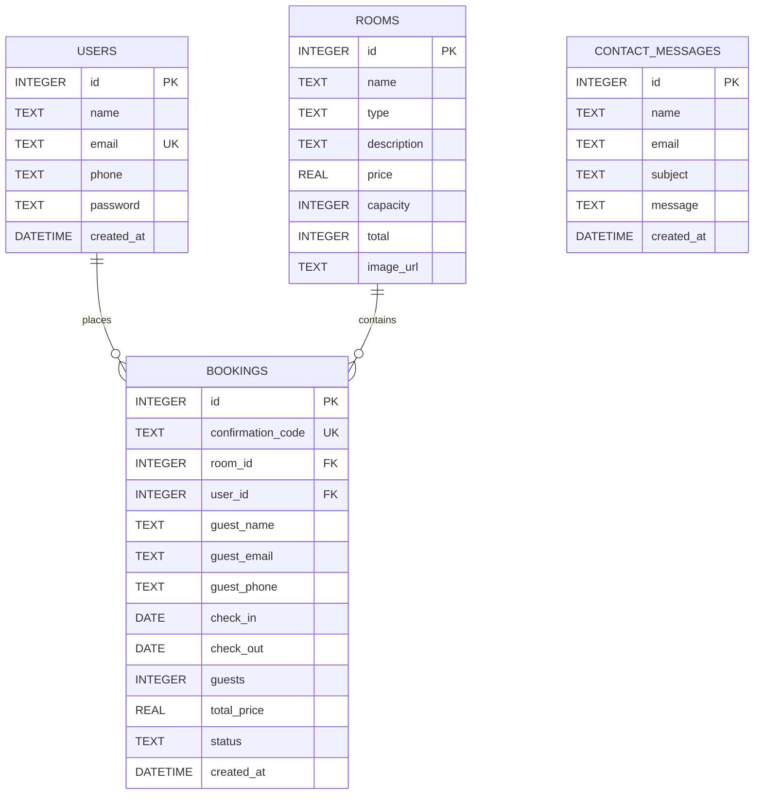

# 🏨 Grand Horizon Hotel — Luxury Booking Web Application

An end-to-end, responsive luxury hotel reservation web application powered by **SQLite 3**, modern CSS3, and modular JavaScript. Features a complete user authentication gate, live room inventory search, dynamic pricing calculation, booking reservation engine with unique confirmation codes, comprehensive hotel history and amenities guide, interactive concierge contact forms, and direct SQLite `.db` database file management.

---

## 🌟 Key Features

1. **🔐 User Authentication System (Login & Register)**
   - Gatekeeping authentication requiring guests to sign in or register before browsing rooms or booking.
   - Account validation with password confirmation and unique email constraints enforced in SQLite.
   - Auto-session restoration via `localStorage`.
   - Pre-fills booking reservations automatically with the logged-in user's profile credentials.

2. **🔍 Interactive Search Engine**
   - Check-in and check-out date pickers with automatic minimum date enforcement (no past dates, check-out dynamically set after check-in).
   - Guest capacity selector (1 to 4+ guests).
   - Real-time filtering matching room capacity requirements.

3. **🛏️ Live Room Listings & Inventory Management**
   - 6 luxury room & suite categories: *Standard Room, Deluxe Room, Superior Suite, Family Suite, Executive Club Suite, and Presidential Penthouse*.
   - High-resolution photography from Unsplash with smooth hover zoom effects.
   - Live availability tracking powered by SQL queries preventing overbooking for overlapping date ranges.
   - Badges for remaining units (e.g. *"Only 2 left!"*) and *"Sold Out"* protection.

4. **📝 Booking & Reservation Engine**
   - Reservation summary card featuring room photo, check-in/out dates, nights calculation, and dynamic price breakdown.
   - Form fields for guest legal name, email, and mobile phone.
   - Real-time validation preventing double-booking of exhausted room units.

5. **🗄️ SQLite 3 Database**
   - Comes with a fully compiled, pre-seeded binary database file: `hotel.db`.
   - Complete SQL DDL schema provided in `schema.sql` (also in `database/schema.sql`).
   - In-browser execution via WebAssembly `sql.js` + client-side persistence in `localStorage`.
   - **One-Click DB Export**: Users can click **"Export .db"** in the navigation bar to download the live, updated `hotel.db` binary file at any time.

6. **🧾 Official Booking Confirmation**
   - Displays a unique alphanumeric reservation code (format: `GH-XXXXXX`).
   - Comprehensive breakdown of suite details, dates, guest counts, and total paid.
   - Instant access to return home or download the updated SQLite database.

7. **🏛️ About Us Page & Hotel Legacy**
   - Comprehensive hotel narrative: *Founded in 1987 by Margaret Thornton*.
   - Architectural photography and luxury statistics (37+ Years of Excellence, 50K+ Guests, 4.9/5 Rating).
   - Comprehensive 8-point amenity grid (Heated Rooftop Pool, L'Horizon Spa, Technogym, 3 Restaurants, Observatory Bar, Valet, Chauffeur, Kids Club).
   - Leadership & Executive team profiles.

8. **📞 Contact & Concierge Portal**
   - Direct contact cards (address, phone numbers, email departments, 24/7 hours, social profiles).
   - Interactive message inquiry form that stores messages directly into the SQLite `contact_messages` table.
   - Embedded interactive Google Map.

9. **📱 100% Fully Responsive Design**
   - Fluid responsive layout optimized for mobile smartphones, tablets, laptops, and ultra-wide desktops.
   - Touch-friendly mobile slide-out navigation menu with hamburger toggle.

---

## 📁 Repository & File Structure

```text
web app/
├── index.html              # Main Single-Page Application (HTML5 semantic markup)
├── hotel.db                # Pre-compiled SQLite 3 binary database file (Root copy)
├── schema.sql              # Complete SQLite DDL schema and initial seed data (Root copy)
├── README.md               # Complete documentation, setup, and database specifications
│
├── css/
│   └── style.css           # Modular, responsive stylesheet with luxury styling
│
├── js/
│   └── app.js              # Core logic: SQLite engine, Auth, Search, Booking, DB export
│
├── database/
│   ├── hotel.db            # Pre-compiled SQLite 3 binary database file
│   └── schema.sql          # SQL schema DDL and sample records
│
└── backend/                # Optional Python / Flask backend server alternative
    ├── app.py              # Flask REST API server connected to hotel.db
    └── requirements.txt    # Flask dependencies
```

---

## 🗄️ Database Architecture & Schema Specification

The database file `hotel.db` contains four relational tables:



### Table Definitions

#### 1. `users`
Stores registered guest credentials and profile contact info.
```sql
CREATE TABLE IF NOT EXISTS users (
    id          INTEGER PRIMARY KEY AUTOINCREMENT,
    name        TEXT NOT NULL,
    email       TEXT NOT NULL UNIQUE,
    phone       TEXT NOT NULL,
    password    TEXT NOT NULL,
    created_at  DATETIME DEFAULT CURRENT_TIMESTAMP
);
```

#### 2. `rooms`
Defines hotel room types, daily tariffs, guest capacity, total available units, and photos.
```sql
CREATE TABLE IF NOT EXISTS rooms (
    id          INTEGER PRIMARY KEY AUTOINCREMENT,
    name        TEXT NOT NULL,
    type        TEXT NOT NULL,
    description TEXT NOT NULL,
    price       REAL NOT NULL,
    capacity    INTEGER NOT NULL,
    total       INTEGER NOT NULL,
    image_url   TEXT NOT NULL
);
```

#### 3. `bookings`
Stores confirmed reservations, guest contact info, date ranges, total price, and unique codes.
```sql
CREATE TABLE IF NOT EXISTS bookings (
    id                INTEGER PRIMARY KEY AUTOINCREMENT,
    confirmation_code TEXT NOT NULL UNIQUE,
    room_id           INTEGER NOT NULL,
    user_id           INTEGER,
    guest_name        TEXT NOT NULL,
    guest_email       TEXT NOT NULL,
    guest_phone       TEXT NOT NULL,
    check_in          DATE NOT NULL,
    check_out         DATE NOT NULL,
    guests            INTEGER NOT NULL,
    total_price       REAL NOT NULL,
    status            TEXT DEFAULT 'CONFIRMED',
    created_at        DATETIME DEFAULT CURRENT_TIMESTAMP,
    FOREIGN KEY (room_id) REFERENCES rooms(id) ON DELETE CASCADE,
    FOREIGN KEY (user_id) REFERENCES users(id) ON DELETE SET NULL
);
```

#### 4. `contact_messages`
Stores inquiries sent via the Contact concierge form.
```sql
CREATE TABLE IF NOT EXISTS contact_messages (
    id         INTEGER PRIMARY KEY AUTOINCREMENT,
    name       TEXT NOT NULL,
    email      TEXT NOT NULL,
    subject    TEXT NOT NULL,
    message    TEXT NOT NULL,
    created_at DATETIME DEFAULT CURRENT_TIMESTAMP
);
```

---

## 🔑 Pre-Seeded Accounts for Testing

You can instantly sign in using either of the following accounts, or click **"Create Account"** to register a new one:

| Role | Email Address | Password | Name |
|---|---|---|---|
| **Demo Guest** | `demo@grandhorizon.com` | `password123` | Demo Guest |
| **Standard Guest** | `john@example.com` | `secret123` | John Doe |

---

## 🚀 How to Run the Project

### Option A: Instant Direct Browser Run (Recommended — No Setup Required)
Because the application embeds the SQLite engine directly via WebAssembly (`sql.js`), it requires **no web server or package installation**:

1. Navigate to the project folder:
   ```text
   C:\Users\hriti\OneDrive\Desktop\web app
   ```
2. Double-click **`index.html`** or right-click &rarr; **Open with** &rarr; **Google Chrome / Microsoft Edge / Firefox**.
3. Sign in using the demo account:
   - Email: `demo@grandhorizon.com`
   - Password: `password123`
4. Search, browse rooms, and complete a test booking!

---

### Option B: Python / Flask Backend Server (Optional)
If you prefer running a local Python web server connected to `hotel.db`:

1. Ensure Python 3.8+ is installed on your machine.
2. Open PowerShell or Command Prompt in the project folder:
   ```powershell
   cd "c:\Users\hriti\OneDrive\Desktop\web app"
   ```
3. Install dependencies:
   ```powershell
   pip install -r backend/requirements.txt
   ```
4. Start the server:
   ```powershell
   python backend/app.py
   ```
5. Open your browser and navigate to:
   ```text
   http://127.0.0.1:5000
   ```

---

## 🛠️ Inspecting the SQLite Database File (`hotel.db`)

You can inspect, query, or edit the provided `hotel.db` file using any standard SQLite utility:

- **GUI Tools**:
  - [DB Browser for SQLite (Free & Open Source)](https://sqlitebrowser.org/)
  - [DBeaver Community](https://dbeaver.io/)
  - VS Code Extension: *SQLite Viewer* by Florian Klampfer
- **Command Line (CLI)**:
  ```bash
  sqlite3 hotel.db
  .tables
  SELECT * FROM rooms;
  SELECT * FROM bookings;
  SELECT * FROM users;
  ```

---

## 📋 Technology Stack

- **Markup**: HTML5 (Semantic, Accessible, High-DPI support)
- **Styling**: Modern CSS3 (Custom Properties, Flexbox, CSS Grid, Glassmorphism, CSS Animations)
- **Scripting**: Modern Vanilla JavaScript (ES6+, Async/Await, Modular architecture)
- **Database Engine**: **SQLite 3**
- **Client DB Driver**: [sql.js](https://github.com/sql-js/sql.js) (Official SQLite compiled to WebAssembly)
- **Iconography**: [FontAwesome 6.5.1](https://fontawesome.com/)
- **Typography**: [Google Web Fonts](https://fonts.google.com/) (*Playfair Display* & *Inter*)
- **Imagery**: [Unsplash](https://unsplash.com/) Curated Luxury Hospitality Photography

---

## 📄 License & Attribution

&copy; 2026 Grand Horizon Hotel & Resorts. Designed and developed as an open demonstration of modern client-side SQLite web applications. Free for educational and commercial customization.
